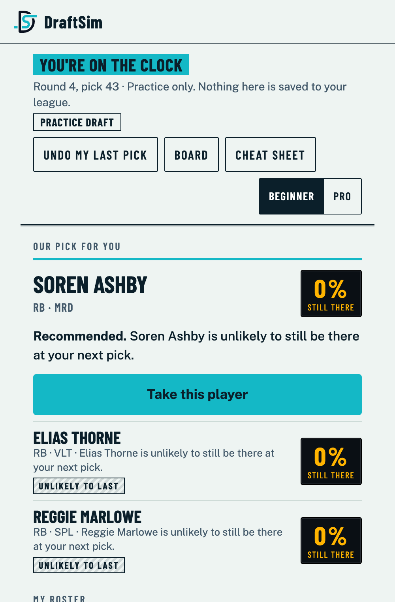
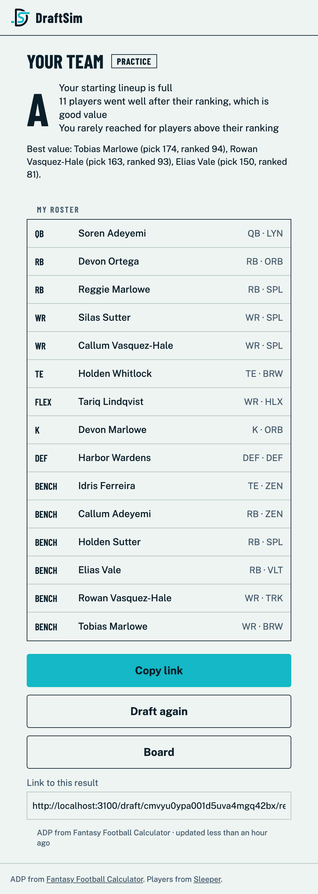
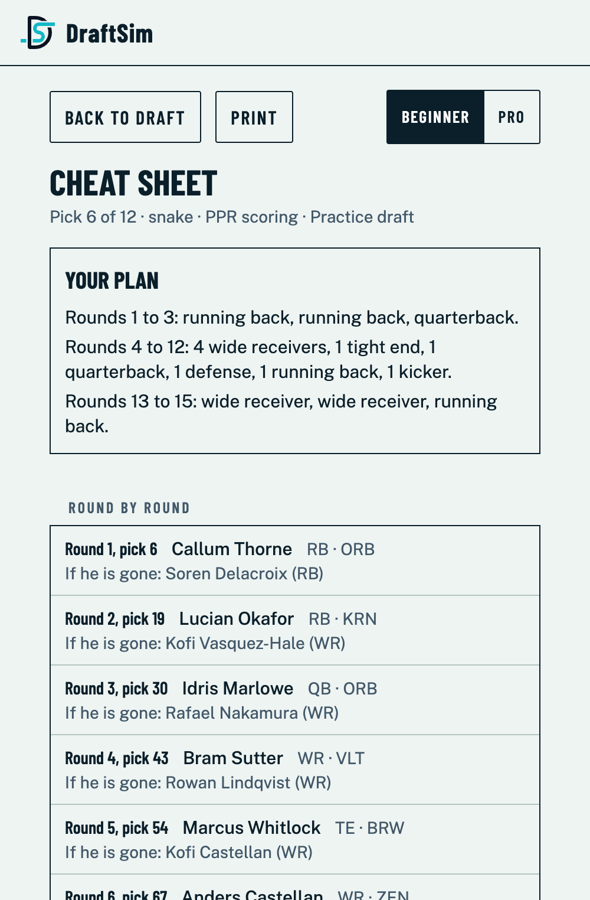
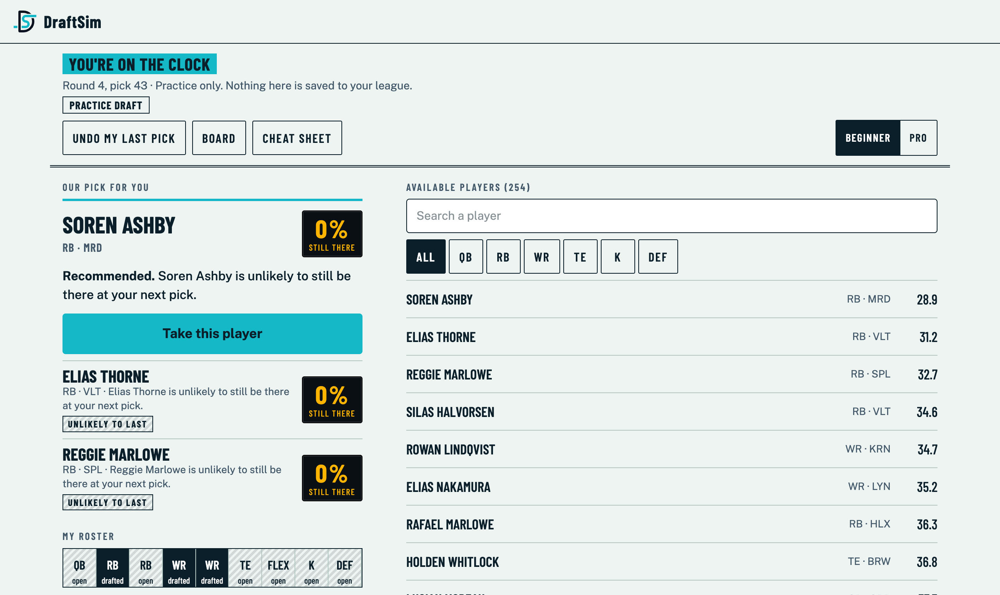
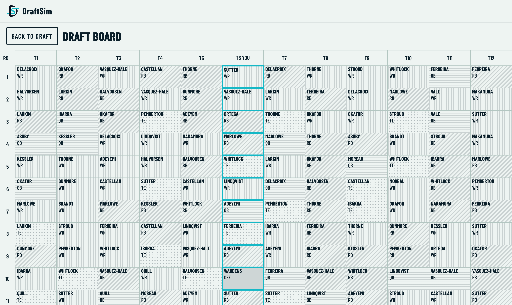
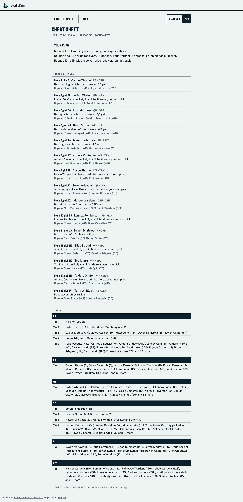
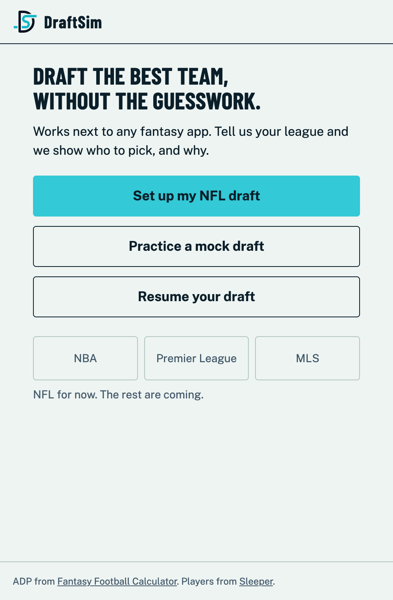
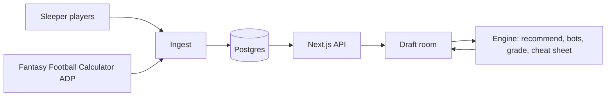

<div align="center">


### Draft the best team, without the guesswork.

A fantasy draft companion that tells you **who to pick, and why, in plain words**, and adapts after every pick.
Works next to any league app: ESPN, Yahoo, Sleeper, or anything else.

[](https://nextjs.org)
[](https://react.dev)
[](https://www.typescriptlang.org)
[](https://www.prisma.io)
[](https://www.postgresql.org)
[](https://tailwindcss.com)
[](https://vitest.dev)


</div>

<p align="center">
  
  &nbsp;&nbsp;
  
  &nbsp;&nbsp;
  
</p>

<p align="center"><sub>All screenshots use invented players and numbers (<code>npm run seed:demo</code>), not real data.</sub></p>

## Why

Some people have never played fantasy and do not know a single player. Others have played for years and want a quick plan. DraftSim serves both:

- **Beginners** get one clear pick, a plain-language reason, and a three-line plan. No setting needs understanding.
- **Veterans** get a dense table, tiers, survival odds and alternates, and set up in under a minute.

## Features

| | |
|---|---|
| **Best pick, with the reason** | Each recommendation weighs player value, the positions you still need, how fast a position is running out, and the chance the player is still there at your next pick. |
| **Log everyone's picks** | One tap per pick, always-visible undo. The recommendations recompute instantly in the browser. |
| **Practice drafts** | Rehearse against ADP-driven bots. The server makes their picks safely, so a refresh or a double tap cannot duplicate or skip a pick. |
| **Results and grade** | A letter grade for your team in plain words, your roster by slot, your best-value picks, and a link to share. |
| **Cheat sheet** | Tiers per position and a round-by-round plan for *your* pick slot, with alternates. Printable. |
| **Draft board** | The whole draft on one grid; position is shown by pattern and label, never by colour alone. |
| **Honest data** | Every ADP number shows its source and age. Stale or failed data is never hidden. |

<details>
<summary><b>More screenshots</b></summary>
<br />

**Draft room on a laptop**



**Draft board**



**Cheat sheet, Pro view**



**Home**



</details>

## How it works



- `src/engine/` is pure TypeScript with no I/O and no `Math.random`. It runs in the browser, so recommendations update with no round trip, and every test is repeatable (bots use a seeded generator).
- Drafts have no accounts: the draft link is the only key.
- Writes use serializable transactions, and conflicts return `409` instead of failing.

## Run it

```bash
cp .env.example .env            # set POSTGRES_PASSWORD, DATABASE_URL, CRON_SECRET
docker compose up -d            # Postgres on 127.0.0.1:5432 (or point DATABASE_URL at any Postgres)
npx prisma migrate deploy
npm run ingest                  # players (Sleeper) and ADP (Fantasy Football Calculator)
npm run dev                     # http://localhost:3000
```

`npm run ingest` also runs daily in production through Vercel Cron (`vercel.json`) at `/api/cron/ingest`, which needs `Authorization: Bearer $CRON_SECRET`.

### Try it without real data

```bash
createdb draftsim_demo
DATABASE_URL=postgresql://localhost:5432/draftsim_demo npx prisma migrate deploy
DATABASE_URL=postgresql://localhost:5432/draftsim_demo npm run seed:demo   # 296 invented players
DATABASE_URL=postgresql://localhost:5432/draftsim_demo npm run build && DATABASE_URL=postgresql://localhost:5432/draftsim_demo npm start
```

The seed script refuses to run on any database whose name does not end in `_demo`.

## Tests

```bash
npm test                         # needs a second database: createdb draftsim_test, then set TEST_DATABASE_URL
DATABASE_URL=<test db url> npx prisma migrate deploy   # once, to create its tables
```

Tests point `DATABASE_URL` at `TEST_DATABASE_URL`, so they never touch your dev data. Also: `npx tsc --noEmit` and `npm run lint`.

## Status

**Works today (NFL):** quick setup, draft room, undo, roster needs, recent picks, draft board, practice drafts with bots, results and grade, printable cheat sheet, data freshness banner.

**Not built yet:** glossary, settings, Sleeper live sync, Premier League, NBA, MLS. Plans live in [`docs/superpowers/plans/`](docs/superpowers/plans/), the design in [`docs/superpowers/specs/`](docs/superpowers/specs/2026-10-27-draftsim-design.md).

## Known limits

- The rate limiter keeps counts in each server instance's memory. Use a shared store (Upstash, Vercel KV) before relying on it across instances.
- Fantasy Football Calculator serves 12-team ADP only, so other league sizes use the 12-team numbers.
- Recommendations use ADP only for now (no projections), so they are a ranking-based plan, not a points forecast.
- Practice-draft bots follow ADP with noise; they are a rehearsal, not a model of real opponents.
- Sleeper's API is free for non-commercial use only.

## Data sources

Players come from the [Sleeper API](https://docs.sleeper.com) and average draft position from [Fantasy Football Calculator](https://fantasyfootballcalculator.com). DraftSim is not affiliated with either.
